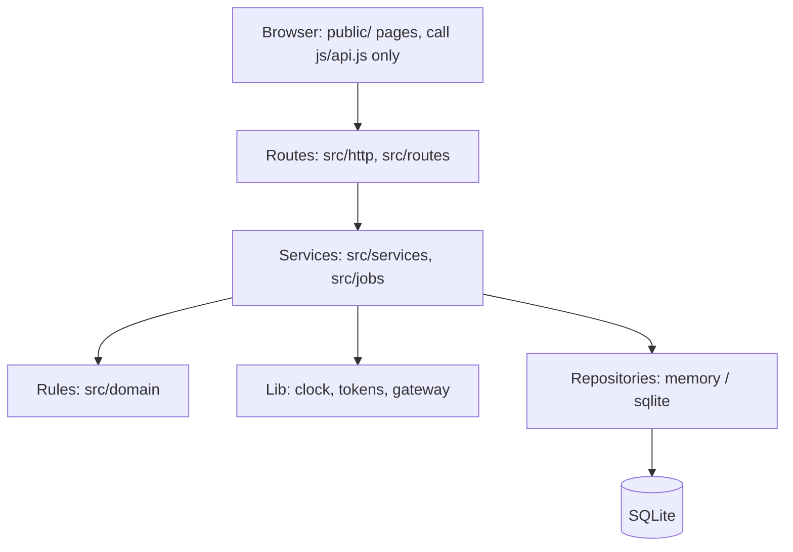
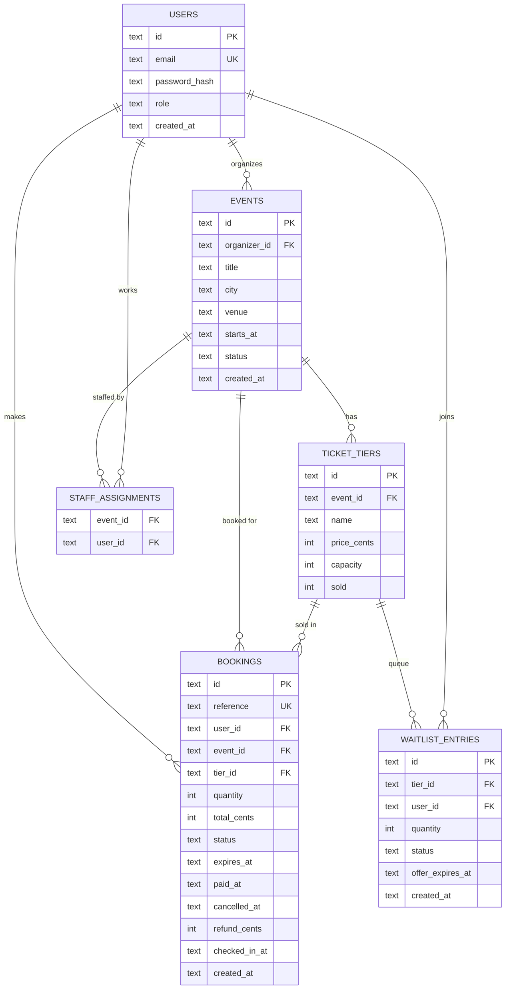
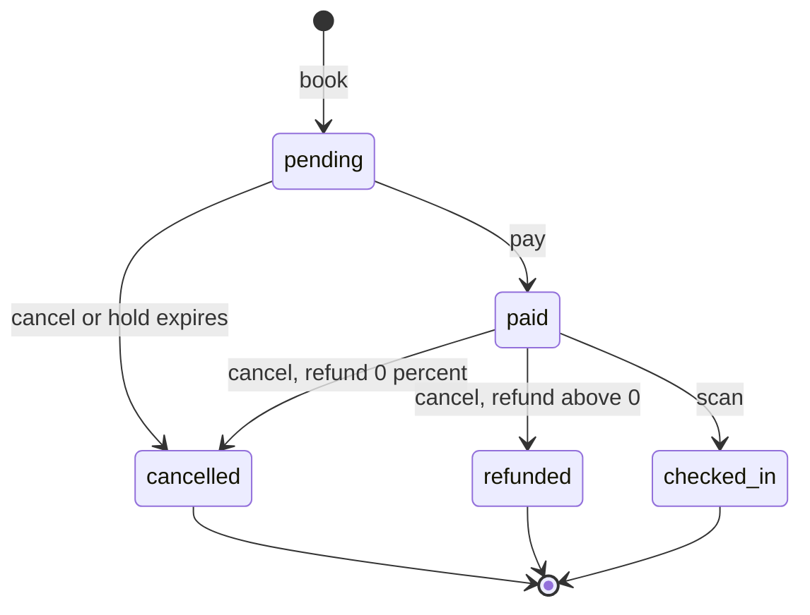

# Architecture and Design

*Layers, data model, booking life cycle and the designs behind the three hard problems*

- **Document:** Architecture (4 of 4: PRD, User Stories, Milestones, Architecture)
- **Version / date:** 1.0 — 3 November 2026
- **Author:** [Your Name] — individual project
- **Source of truth:** Build 3 prompt (docs/architecture.md with three diagrams and one sentence per layer), plus the file lists and rules in Builds 4 to 9.
- **How to use:** This file is the design for `docs/architecture.md` (Build 3). Diagrams are drawn in plain text so they look the same in any editor. Mermaid versions are in the appendix at the end.

## 1. Principles

- **Plain and dependency-free.** Node.js 22.13+, node:http, node:sqlite, node:crypto, node:test. No outside packages, no framework, no ORM.
- **Layered, calls go down only.** Routes call services; services call rules, lib and repositories; nothing calls upwards.
- **Rules are pure.** Business decisions live in src/domain as functions of their inputs: state machine, refund policy, search, sorting.
- **The database is the referee.** Concurrency is solved with atomic SQL statements and constraints, never with JavaScript locks.
- **Exactly once.** Anything that must happen once (release seats, charge a card, admit a ticket) is guarded by a compare-and-set on a status column.
- **Money is whole cents (kobo).** Never decimals.

## 2. Diagram 1: the layers

```text
+----------------------------------------------------------------+
| BROWSER  -  public/                                            |
| HTML, CSS, JavaScript pages. Pages call js/api.js only.        |
+----------------------------------------------------------------+
                                 |
                                 v   HTTP, JSON
+----------------------------------------------------------------+
| ROUTES  -  src/http, src/routes                                |
| router, app, guards, security headers, rate limit              |
+----------------------------------------------------------------+
                                 |
                                 v   calls one service
+----------------------------------------------------------------+
| SERVICES  -  src/services, src/jobs                            |
| event, booking, auth, seat, waitlist, check-in, maintenance    |
+----------------------------------------------------------------+
          |                      |                      |
          v                      v                      v
+------------------+   +------------------+   +------------------+
| RULES            |   | LIB              |   | REPOSITORIES     |
| src/domain       |   | src/lib          |   | memory / sqlite  |
| pure decisions   |   | clock, tokens,   |   | stores data      |
+------------------+   | mock gateway     |   +------------------+
                       +------------------+
                                                        |
                                                        v   SQL with ?
                                              +------------------+
                                              | SQLITE           |
                                              | atomic UPDATE    |
                                              +------------------+

Rule: arrows only point down.
Services receive repositories as arguments (dependency injection).
```

Figure 1. Layered design. Each box may only call the box below it. The Rules, Lib and Repositories boxes are siblings that services use side by side.

### What each layer may and may not do

| Layer | May | May not |
|---|---|---|
| **Browser** (public/) | Render data and call functions exported by js/api.js. | Call fetch directly from a page, use innerHTML for data, or hold a business rule. |
| **Routes** (src/http, src/routes) | Parse the request, check the token and role, call one service, and turn the result or error into JSON. | Contain business rules, talk to the database, or let a stack trace reach the client. |
| **Services** (src/services, src/jobs) | Run one use case by combining rules, lib helpers and an injected repository. | Import a repository directly, know anything about HTTP, or read the system clock directly. |
| **Rules** (src/domain) | Decide: pure functions for the state machine, refund policy, search, sorting and validation. | Do input or output, read the clock, or mutate their inputs. |
| **Lib** (src/lib) | Provide small tools: clock, password hashing, tokens, rate limiting, the mock payment gateway. | Know about routes, services or business flows. |
| **Repositories** (src/repositories) | Store and fetch data, and run the atomic statements that guard seats and status changes. | Decide business policy (refund amounts, who may do what) or know about HTTP. |
| **Database** (SQLite) | Hold the data and enforce PRIMARY KEY, FOREIGN KEY, UNIQUE and CHECK constraints. | Be bypassed: even if a bug slips through, CHECK (sold >= 0 AND sold <= capacity) still holds. |

### Folder layout

```text
src/
  domain/        errors.js ids.js waitlistQueue.js inventory.js sorting.js eventSearch.js
                 bookingStateMachine.js refundPolicy.js
  http/          router.js app.js guards.js securityHeaders.js
  routes/        auth.js events.js bookings.js waitlist.js checkin.js
  services/      eventService.js bookingService.js authService.js seatService.js
                 waitlistService.js checkinService.js
  repositories/  memory.js sqlite.js
  db/            schema.sql connection.js
  lib/           clock.js password.js token.js ticketToken.js rateLimit.js mockPaymentGateway.js
  jobs/          maintenance.js
  config.js  server.js
public/          index.html event.html login.html tickets.html organizer.html checkin.html
  css/styles.css   js/ui.js api.js session.js mockData.js qr.js(vendored)   js/pages/*.js
test/            *.test.js        scripts/  demo.js benchmark-lookup.js seed.js oversell-demo.js
docs/            architecture.md api-examples.md security-checklist.md ai-log.md ...
.github/workflows/ci.yml        .env.example
```

## 3. Diagram 2: the data model

```text
users (1) ------< events (N)               an organizer owns many events
events (1) -----< ticket_tiers (N)         an event has many ticket tiers
users (1) ------< bookings (N)             an attendee makes many bookings
events (1) -----< bookings (N)             a booking is for one event
ticket_tiers (1) < bookings (N)            a booking is for one tier
ticket_tiers (1) < waitlist_entries (N)    a sold-out tier has a queue
users (1) ------< waitlist_entries (N)     a person can wait on many tiers
events (N) >-----< users (N)               via staff_assignments (who may scan)

Read "A (1) ---< B (N)" as: one A has many B. The arrow points to the many side.
```

| Table | Columns |
|---|---|
| `users` | **PK** id, email (UNIQUE), password_hash, role (organizer / attendee / staff), created_at |
| `events` | **PK** id, **FK** organizer_id, title, city, venue, starts_at (ISO), status (draft / published), created_at |
| `ticket_tiers` | **PK** id, **FK** event_id, name, price_cents (>= 0), capacity (>= 1), sold (0..capacity) |
| `bookings` | **PK** id, reference (UNIQUE), **FK** user_id, **FK** event_id, **FK** tier_id, quantity (1..10), total_cents, status (5 states), expires_at, paid_at, cancelled_at, refund_cents, checked_in_at, created_at |
| `waitlist_entries` | **PK** id, **FK** tier_id, **FK** user_id, quantity (1..10), status (waiting / offered / accepted / expired), offer_expires_at, created_at, UNIQUE(tier_id, user_id) |
| `staff_assignments` | **PK** (event_id, user_id), **FK** event_id, **FK** user_id |

Figure 2. Data model. The tutor's Build 3 prompt names events, ticket tiers, bookings and users. **waitlist_entries** and **staff_assignments** are required by Build 8 and by the README ("staff ... for events they are assigned to") and are added here.

### Constraints (Build 5)

| Table | Constraint | Why |
|---|---|---|
| users | email UNIQUE; role CHECK in (organizer, attendee, staff) | S01 EMAIL_TAKEN; only three roles exist |
| events | FK organizer_id; status CHECK in (draft, published) | Ownership (S13); drafts stay private |
| ticket_tiers | FK event_id; CHECK (price_cents >= 0); CHECK (capacity >= 1); **CHECK (sold >= 0 AND sold <= capacity)** | Whole-number money; the last line of defence against overselling |
| bookings | reference UNIQUE; CHECK (quantity BETWEEN 1 AND 10); CHECK status in five states; FKs to users, events, tiers | O(1) lookup by reference; booking limits; state machine values only |
| waitlist_entries | UNIQUE (tier_id, user_id); CHECK status in four values | ALREADY_ON_WAITLIST |
| staff_assignments | PRIMARY KEY (event_id, user_id) | A staff member is assigned to an event once |

All queries use placeholders (`?`); SQL is never built by joining strings.

## 4. Diagram 3: the booking life cycle (state machine)

```text
 [start] --book--> PENDING --pay--> PAID --scan--> CHECKED_IN (final)
                      |               |
                      |               +--cancel, refund > 0 ----------> REFUNDED (final)
                      |               |
                      |               +--cancel, refund 0% ----------> CANCELLED (final)
                      |
                      +--cancel, or hold expires ---------------> CANCELLED (final)

Final states: CHECKED_IN, REFUNDED, CANCELLED. Nothing leaves them.
Any other move is refused with INVALID_TRANSITION.
```

Figure 3. Booking states, from the Build 3 prompt. States and moves are stored as data in src/domain/bookingStateMachine.js with canTransition and assertTransition.

| From | To | Trigger | Side effects (exactly once) | Story |
|---|---|---|---|---|
| (new) | pending | Attendee books 1 to 10 tickets | Seats reserved by atomic UPDATE; expires_at = now + hold time | S06 |
| pending | paid | Mock payment succeeds | Gateway charged once (idempotent by reference); paid_at set | S07 |
| pending | cancelled | Attendee cancels, or the maintenance job finds it older than the hold time | Seats released once; no money moved | S09, S10 |
| paid | refunded | Attendee cancels and refund is above 0 (event at least 2 days away) | Refund = policy % of amount, Math.floor; gateway refund; seats released once | S09 |
| paid | cancelled | Attendee cancels with refund of 0% (under 2 days) | No refund; seats still released once | S09 |
| paid | checked_in | Staff scan a valid, matching, unused code | checked_in_at recorded in one atomic UPDATE | S14, S15 |

> **Design decision A6.** The tutor lists both *cancelled* and *refunded* as final states but does not say which a paid cancel ends in. We use *refunded* when money goes back and *cancelled* when it does not. Confirm with the tutor; it is a one-line change in the cancel service.

## 5. Diagram 4: waitlist offer life cycle

```text
 [join]                                   (only when the tier is sold out)
    |
    v
 WAITING
    |   seat freed, first person in line
    v
 OFFERED ---- accept before the deadline ----> ACCEPTED (final)
    |         a pending booking is created for the held seats;
    |         the person then pays within the hold time
    |
    |   deadline passes   (late accept gives OFFER_EXPIRED)
    v
 EXPIRED (final) ----> the held seats are offered to the next person in line
```

Figure 4. Waitlist entry states (Build 8, S11 and S12). An offer really holds the seats: they are counted as sold for the offered person until accepted or expired.

## 6. Designs for the three hard problems

### 6.1 Overselling (Build 5, S08)

The unsafe version reads the seats left, decides, then writes. Between the read and the write another request can do the same, so two buyers win the last seat. The fix moves the decision into one SQL statement that the database runs atomically:

```sql
UPDATE ticket_tiers
   SET sold = sold + ?
 WHERE id = ? AND sold + ? <= capacity;
-- changed rows = 1  -> we won the seats, create the booking
-- changed rows = 0  -> throw SOLD_OUT, nothing changed
```

| Idea | Why it fails or works |
|---|---|
| Lock variable in JavaScript | Fails: it only protects one process, and with async code an await lets another request run between the check and the write. A second server instance has its own variable. |
| Check twice | Fails: checking again only shrinks the gap between read and write; it does not remove it. |
| One atomic UPDATE with the condition inside | Works: the check and the write are one indivisible step, and the number of changed rows tells us who won. |
| CHECK (sold >= 0 AND sold <= capacity) | Safety net: even if code is wrong, the database refuses an impossible state. |

**Proof:** oversell-demo.js first shows the bug (written with an await between check and write so the race is visible), then the fix. test/oversell.test.js fires 50 bookings at 1 seat with Promise.all and expects 1 success and 49 SOLD_OUT. It must be run once with the fix removed to prove it fails.

### 6.2 Refunds (Build 8, S09 and S10)

| Time before event starts | Refund | Example (amount 500,000 kobo) |
|---|---|---|
| 7 days or more (exactly 7 days included) | 100% | 500,000 |
| 2 days or more, under 7 days (exactly 2 days included) | 50% | 250,000 |
| Under 2 days | 0% | 0 (seats still released) |
| Event has started | none | EVENT_STARTED error |

**Pure function:** `calculateRefund({ amountCents, startsAt, now })` uses Math.floor on cents (for example 50% of 333 is 166). The clock is passed in, so tests can place "now" exactly on every boundary: exactly 7 days, 6 days 23 hours, exactly 2 days, 1 day 23 hours.

**Exactly-once release:** the cancel service first runs `UPDATE bookings SET status = ? WHERE reference = ? AND status = 'paid'` (compare-and-set). Only the request that changed one row refunds the card and releases the seats; a second cancel changes zero rows and is rejected, so seats are never released twice.

**Expiry:** the maintenance job (setInterval in the server, called directly in tests) cancels pending bookings older than the hold time using the same compare-and-set, releases their seats once, then offers the freed seats to the waitlist.

### 6.3 Waitlists (Build 8, S11 and S12)

- **Order:** strictly first in, first out, by created_at then id. Build 1 teaches the in-memory FIFO queue (linked list, O(1)); in SQLite the same order comes from the table.
- **Join rules:** only for a sold-out tier (NOT_SOLD_OUT otherwise); once per person per tier (ALREADY_ON_WAITLIST).
- **Offer:** when seats are freed, the service takes the first waiting entry, reserves its seats with the same atomic UPDATE as a normal booking, marks it offered and sets offer_expires_at (now + offer time). The seats are therefore really held.
- **Pass-on:** when the job finds an offer past its deadline, a compare-and-set moves offered to expired (once), the held seats are released, and the next person is offered them.
- **Accept:** before the deadline, accepting creates a pending booking for the held seats (no second reservation); after the deadline the answer is OFFER_EXPIRED.
- **Head of line:** if the first person wants more seats than are free, the line waits (assumption A4); nobody jumps the queue.

## 7. How a request travels through the layers

| Use case | Route (checks only) | Service (decides the flow) | Rules / lib / repository |
|---|---|---|---|
| **Book tickets** POST /api/bookings | requireUser (attendee); parse JSON | bookingService.createBooking: validate; load published event and tier | Rules: quantity 1 to 10. Repo: atomic seat UPDATE, then insert pending booking with expires_at. SOLD_OUT if 0 rows changed. |
| **Pay** POST /api/bookings/:reference/pay | requireUser; owner check | bookingService.pay: load booking; reject if expired; assertTransition(pending to paid) | Lib: mock gateway charge, idempotent by reference. Repo: compare-and-set pending to paid. Declined: PAYMENT_DECLINED, stays pending. |
| **Cancel + refund** POST /api/bookings/:reference/cancel | requireUser; owner check | bookingService.cancel: assertTransition; calculateRefund; compare-and-set status | Rules: refundPolicy. Lib: gateway refund. Repo: release seats once. Then waitlist offer. |
| **Check in** POST /api/checkin | requireRole(staff); rate limit per IP | checkinService.scan: verify signature; assigned to this event? | Lib: ticketToken verify (constant time). Repo: `UPDATE bookings SET status='checked_in', checked_in_at=? WHERE reference=? AND status='paid'`; 1 row = admitted. |

**Error handling:** services and rules throw `DomainError(code, message)`. One error handler in app.js maps every code to an HTTP status and returns `{"error":{"code","message"}}`. Unknown errors become a generic 500 of the same shape; the stack trace is logged on the server only.

## 8. API surface

Routes named in the tutor's prompts are plain; routes marked * are our additions needed by the stories or the screens.

| Method and path | Who | Story | Notes |
|---|---|---|---|
| GET /health | anyone | Build 3 | {"status":"ok"} |
| POST /api/auth/signup | anyone | S01 | email, password (8+), role; EMAIL_TAKEN |
| POST /api/auth/login | anyone | S01 | INVALID_CREDENTIALS (same message); rate limited |
| GET /api/auth/me | logged in | S01 | current user |
| POST /api/events | organizer | S02 | creates a draft |
| POST /api/events/:id/tiers | organizer (owner) | S03 | price_cents, capacity |
| POST /api/events/:id/publish | organizer (owner) | S04 | INVALID_STATE with no tiers |
| POST /api/events/:id/unpublish * | organizer (owner) | S04 | back to draft |
| GET /api/events | anyone | S05 | published only; q, city, from, to, maxPriceCents, onlyAvailable, sortBy |
| GET /api/events/:id * | anyone | S05, S06 | event with its tiers |
| GET /api/events/:id/bookings * | organizer (owner) | README | bookings of own events only |
| POST /api/bookings | attendee | S06 | SOLD_OUT, VALIDATION |
| GET /api/bookings * | attendee | S13 | own bookings only |
| GET /api/bookings/:reference * | attendee (owner) | S13 | other person's booking: FORBIDDEN (see A5) |
| POST /api/bookings/:reference/pay | attendee (owner) | S07 | PAYMENT_DECLINED, INVALID_TRANSITION, BOOKING_EXPIRED |
| GET /api/bookings/:reference/refund-preview * | attendee (owner) | S09 | amount shown before the user confirms |
| POST /api/bookings/:reference/cancel | attendee (owner) | S09 | unpaid in Build 4; paid with refund in Build 8 |
| POST /api/waitlist | attendee | S11 | NOT_SOLD_OUT, ALREADY_ON_WAITLIST |
| GET /api/waitlist/mine * | attendee | S12 | position and offers with deadline |
| POST /api/waitlist/:id/accept | attendee (owner) | S12 | OFFER_EXPIRED after the deadline |
| POST /api/checkin | staff | S14, S15 | INVALID, duplicate, rejected, FORBIDDEN |

## 9. Security design (Builds 7 and 9)

| Topic | Design |
|---|---|
| Passwords | scrypt from node:crypto, random salt per password, constant-time comparison (timingSafeEqual). Never stored, logged or returned in plain text. |
| Login tokens | HS256 signed with TOKEN_SECRET from the environment. Payload: user id, role, expiry (24 h, assumption A3). Reject expired tokens and any header whose alg is not HS256. |
| Authentication vs authorization | requireUser proves who you are (UNAUTHENTICATED); requireRole and ownership checks decide what you may do (FORBIDDEN). Both run on the server. |
| QR ticket token | `base64url(payload).base64url(HMAC-SHA256)`. Payload holds only the booking reference and issued-at time, never a name or email. Signed with TICKET_SECRET, a **different** secret from login tokens; compared in constant time. |
| Forged / repeated scans | A bad signature is INVALID. A valid code is admitted only by the atomic UPDATE; the loser of a simultaneous scan sees the duplicate with the first-use time. |
| Security headers | Content-Security-Policy (default-src 'self', script-src 'self' so no inline scripts, object-src 'none', frame-ancestors 'none'), X-Content-Type-Options: nosniff, Referrer-Policy. |
| Rate limiting | In-memory counter per IP for login (10/min) and check-in (30/min), assumption A9; over the limit gives RATE_LIMITED. |
| Static files | Resolved against public/ and refused if the path would leave that folder. |
| Frontend | Elements are built with textContent, never innerHTML, for any data. |
| Secrets | Only environment variables. `.env` and `*.db` are in .gitignore; `.env.example` lists names with no real values. The app refuses to start in production without secrets (no default value). |

## 10. Frontend, testing and CI

### Frontend

- Pages (index, event, login, tickets, organizer, checkin) import functions from `js/api.js` only. In Build 6 api.js reads mockData.js; in Build 7 it uses fetch with the bearer token and the same function names, so pages do not change.
- `ui.js` offers el(tag, props, children); `session.js` stores the token; one function formats money (250000 kobo shows as the naira amount).
- Accessibility: labels on every control, buttons for actions, links for navigation, "Sold out" as text, countdown that updates without stealing focus.

### Testing strategy

| Level | What it proves | Tools |
|---|---|---|
| Unit (rules) | State machine moves, refund boundaries, search, merge sort stability, token signing | node:test, node:assert/strict, controllable clock |
| Service | Use cases against the memory repository: booking, pay, cancel, expiry, waitlist order | node:test |
| API | Real server on a free port: status codes, error shape, roles, ownership | node:http client |
| Concurrency | 50 buyers for 1 seat; two cancels; two scans of one code: exactly one winner each | Promise.all against SQLite; run once without the fix to prove failure |
| Screen | Browse, book, pay, decline-retry, sold-out, countdown, QR scan path | Manual checklist with screenshots |

**CI:** .github/workflows/ci.yml runs on every push and pull request: set up Node 22, run `npm test`. A failing test shows as a failed check (S16). **Coverage (above benchmark):** `node --test --experimental-test-coverage`.

## 11. Decision log

| # | Decision | Reason |
|---|---|---|
| D1 | No outside packages | Tutor's rule; also removes supply-chain risk and keeps the project easy to run |
| D2 | State machine stored as data | One place lists every legal move; tests can loop over all pairs |
| D3 | Repositories injected into services | Memory (Build 4) and SQLite (Build 5) are swappable without changing services |
| D4 | Money as integer cents (kobo) | Decimals cause rounding errors; refunds use Math.floor |
| D5 | Concurrency solved in SQL | JavaScript locks fail across awaits and processes; the database is the single referee |
| D6 | Compare-and-set on status for every once-only action | Gives idempotent cancel, expiry, offer and check-in |
| D7 | Separate secrets for login tokens and ticket tokens | A leaked or guessed login token can never be turned into a ticket |
| D8 | Mock gateway is idempotent by booking reference | A repeated pay request cannot charge twice |
| D9 | Waitlist offer reserves seats immediately | "A waitlist offer really holds the seats" (Build 8 rule) |
| D10 | One error shape for every failure | Clients handle one format; no stack traces reach users |
| D11 | Open points A5, A6, A7 flagged for the tutor | The tutor's files are ambiguous; each has a default that is a one-line change |

## Appendix: Mermaid source (optional)

The Build 3 prompt asks for Mermaid diagrams. These blocks draw as diagrams on GitHub; in VS Code they show as code unless a Mermaid preview extension is installed. The plain-text diagrams above are the main version, and this appendix can be deleted if not needed.

### Diagram 1: the layers



### Diagram 2: the data model



### Diagram 3: the booking life cycle

